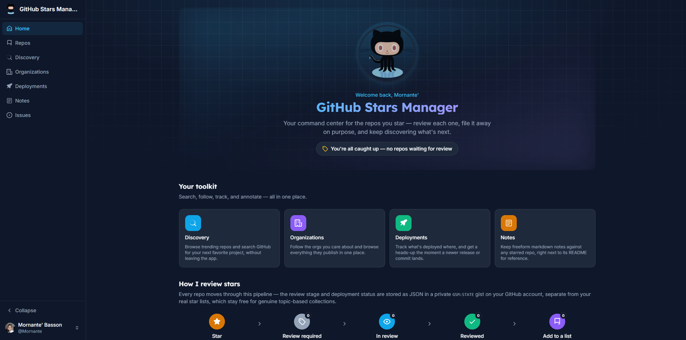
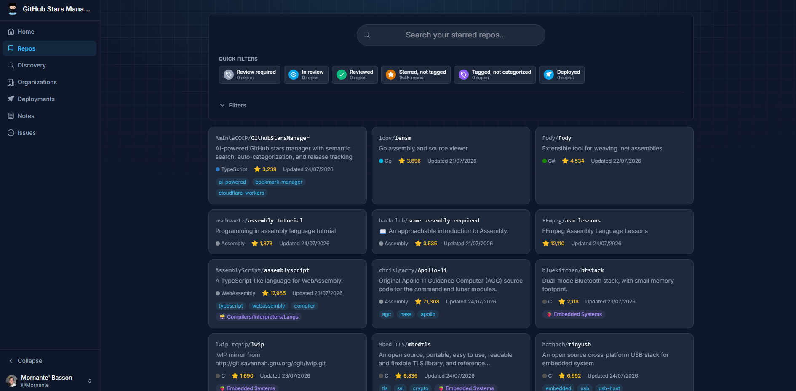
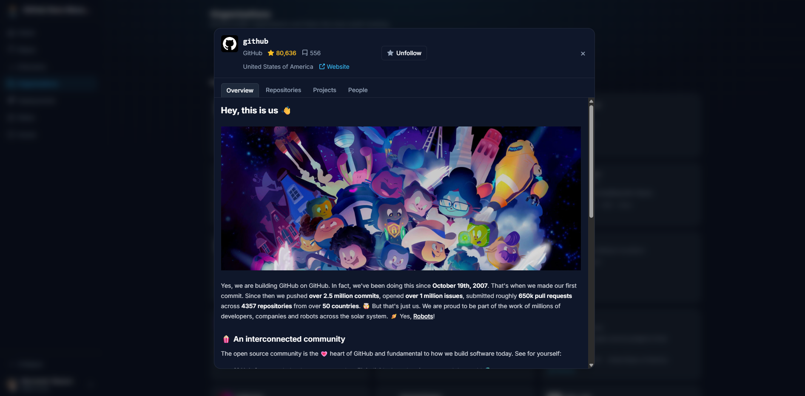

# GitHub Stars Manager

A personal command center for the repos you star on GitHub — review each one, file it into a real star list on
purpose, track what's deployed where, keep markdown notes, and discover trending repos you haven't starred yet.

[](https://github.com/Mornante/GithubStarsManager/actions/workflows/ci.yml)
[](https://github.com/Mornante/GithubStarsManager/actions/workflows/codeql.yml)
[](https://github.com/Mornante/GithubStarsManager/actions/workflows/secret-scan.yml)

Runs entirely in the browser: you connect with a personal access token, and the app talks directly to
`api.github.com`. There's no backend and no server-side storage — your token stays in your browser's local storage,
and cross-device state (review stage tags, deployment records, notes) is stored as JSON in a private gist on your
own GitHub account (`GSM:STATE`).

## Showcase


_The home dashboard — live review-stage stats, your toolkit, and the review pipeline at a glance._


_Browsing starred repos — quick-filter cards, a full filter bar, and grid or compact views._


_An organization's detail view — Overview, Repositories, Projects, and People tabs._

## Features

- **Review pipeline** — every starred repo moves through `Review required → In review → Reviewed`, then gets filed
  into a real, topic-based star list. The stage (and deployment status) lives as JSON in a private `GSM:STATE` gist
  on your own account, kept separate from your actual GitHub star lists.
- **Powerful repo browsing** — filter by language, topic, license, star list, review stage, or deployment status;
  one-click quick-filter cards; grid or compact layouts; infinite scroll.
- **Organizations** — follow the orgs you care about and browse their profile README, repositories, GitHub Projects,
  and public members, all from one tabbed modal.
- **Deployment tracking** — record what's deployed where, and get a drift warning the moment a newer release or
  commit lands on the default branch.
- **Notes** — freeform markdown notes against any starred repo, right next to its README.
- **Discovery** — browse trending repos or search all of GitHub without leaving the app.
- **Issues** — every GitHub issue you're involved in, across every repo, in a compact list with an indicator for
  issues that changed since you last opened them.
- **Repo detail tabs** — Overview (README), Issues, Pull requests, and Projects, all scoped to that one repository.
- **Light and dark themes**, matching your system preference.
- **No backend** — everything talks directly to `api.github.com`; your token stays in browser local storage and
  cross-device state lives in your own private gist.

## Getting started

```sh
npm install
npm run dev
```

Open the app and paste a [classic personal access token](https://github.com/settings/tokens/new) with these scopes:

| Scope          | Why                                                                                           |
| -------------- | --------------------------------------------------------------------------------------------- |
| `user`         | Manage star lists — tagging and categorizing repos.                                           |
| `public_repo`  | Read and star public repos.                                                                   |
| `read:org`     | Browse and follow public organizations.                                                       |
| `gist`         | Create and update the private `GSM:STATE` gist that stores your tags, deployments, and notes. |
| `read:project` | View an organization's GitHub Projects in the Projects tab.                                   |

## Scripts

| Script                 | What it does                                   |
| ---------------------- | ---------------------------------------------- |
| `npm run dev`          | Start the Vite dev server                      |
| `npm run build`        | Type-check (`tsc -b`) and build for production |
| `npm run preview`      | Preview a production build locally             |
| `npm run lint`         | Run oxlint                                     |
| `npm test`             | Run the test suite once                        |
| `npm run test:watch`   | Run the test suite in watch mode               |
| `npm run format`       | Format the codebase with Prettier              |
| `npm run format:check` | Check formatting without writing changes       |

## Project structure

- `src/api` — thin wrappers over GitHub's REST and GraphQL APIs; no state, no React.
- `src/store` — Zustand stores, one per domain (auth, starred repos, GSM state, organizations, trending, issues, toasts).
  Each store owns its own fetch/optimistic-update/rollback logic for its slice of data.
- `src/hooks` — cross-cutting React hooks (data loading, URL-synced filters, dismissable dropdowns, infinite scroll).
- `src/selectors` — pure functions over domain data (filtering, sorting, deployment drift calculation).
- `src/config` — declarative, data-driven definitions (filter fields, quick-filter cards, review-stage labels).
- `src/components` — presentational and feature components, grouped by area (`repos/`, `orgs/`, `deployments/`,
  `notes/`, `issues/`, `shared/`).
- `src/routes` — one component per top-level page, wired up in `src/App.tsx`.
- `.github/workflows` — CI (lint, format check, type-check, build, test), CodeQL analysis, and gitleaks secret
  scanning; `.github/dependabot.yml` keeps npm and Action dependencies current.

## Tech stack

React 19, TypeScript (strict), React Router, Zustand, Tailwind CSS v4, Vite, Vitest, oxlint.
